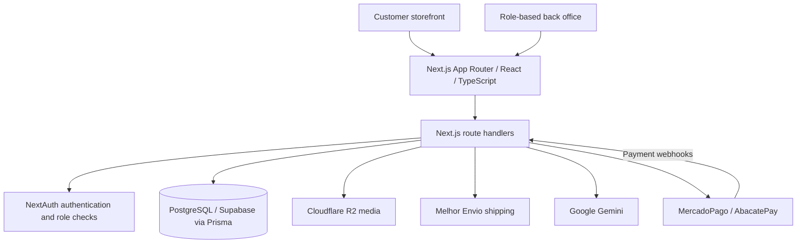

# E-Commerce & Services Platform

**A Next.js and TypeScript platform that brings physical-product sales and bookable services into one storefront and operations back office.** It connects catalog browsing, checkout, payments, shipping, scheduling and customer management, with AI assistance inside selected workflows.

**[Open the live demo](https://vendaprodutosonline.vercel.app)** · [Architecture](#documented-architecture) · [Trade-offs](#architecture-trade-offs) · [Suggested walkthrough](#suggested-walkthrough)

> **Public case study; private application source.** This repository explains the product scope and architecture. It does not contain a runnable application or a public test suite. A guided source-code walkthrough is available on request.

## The problem and the product

A business selling both products and services needs to coordinate two different journeys: a product purchase may require shipping, while a service purchase needs scheduling. The platform brings those journeys together with customer, order and catalog management for the operating team.

| User          | Main workflows                                                                              |
| ------------- | ------------------------------------------------------------------------------------------- |
| Customer      | Browse products/services, find daily deals, manage a cart, check out and schedule services. |
| Staff         | Work with the operational areas exposed to their role.                                      |
| Administrator | Manage catalog, customers/CRM, orders and analytics through the back office.                |

## Documented architecture

The application is organized as a single **Next.js App Router** project. React storefront and back-office views use domain-oriented route handlers, a typed Prisma data layer and PostgreSQL. Payment, shipping, storage and AI providers sit behind the backend integration boundary.

The backend comprises **40+ REST endpoints** across catalog, cart, orders, payments, scheduling, CRM and analytics.

## Capabilities and integration boundaries

| Area                   | Documented implementation                                                             | Engineering consideration                                                                                                                 |
| ---------------------- | ------------------------------------------------------------------------------------- | ----------------------------------------------------------------------------------------------------------------------------------------- |
| Commerce               | Product/service catalog, categories, search, cart and time-limited deals.             | Prices, availability and offer windows must remain consistent through checkout.                                                           |
| Payments               | Credit-card and Pix flows using MercadoPago and AbacatePay; HMAC-verified webhooks.   | Verify authenticity before changing order state. Signature validation alone does not establish replay protection or exactly-once updates. |
| Fulfillment            | Shipping quotes and labels through Melhor Envio; a service-scheduling flow.           | Shipping and scheduling have different data and failure cases.                                                                            |
| Operations             | CRM, order/catalog management, analytics and customer/staff/admin roles.              | Backend authorization must protect resources independently of which dashboard is visible.                                                 |
| AI assistance          | Gemini-powered customer chat, product-description generation and analytics summaries. | Provider latency, cost and generated-content quality need explicit handling.                                                              |
| Delivery and discovery | Vercel hosting; SSG, SSR and ISR selected by route.                                   | Cache freshness and rendering cost vary by page and data sensitivity.                                                                     |

## Architecture trade-offs

The following trade-offs follow from the documented architecture and provide a starting point for a technical discussion.

| Choice                                         | Why it fits this product                                                                                              | Trade-off and when to reconsider                                                                                                                                       |
| ---------------------------------------------- | --------------------------------------------------------------------------------------------------------------------- | ---------------------------------------------------------------------------------------------------------------------------------------------------------------------- |
| **One Next.js application for UI and backend** | Keeps storefront, back-office and API changes in one TypeScript project and deployment.                               | Domains share a release and runtime boundary. Independent services become more useful if ownership, scaling or release needs diverge.                                  |
| **PostgreSQL with Prisma**                     | Relational data suits customers, orders, catalog records and scheduling; generated types support application changes. | ORM convenience does not replace query-plan, transaction or migration review. Complex reporting and contention may need explicit SQL or more targeted data access.     |
| **Products and services in one platform**      | Reuses identity, checkout and operational tooling across both offerings.                                              | Shipping, availability and appointment rules cannot be treated as identical. Domain boundaries matter as the product grows.                                            |
| **External payment and shipping providers**    | Uses established services for payment methods, Pix, rates and labels.                                                 | Provider failures, webhook timing, reconciliation and sandbox/live configuration add integration work. Critical order state must remain controlled by the application. |
| **SSG/SSR/ISR selected by route**              | Allows catalog/discovery pages and personalized views to use different rendering strategies.                          | Caching adds invalidation and freshness decisions; private or frequently changing data requires special care.                                                          |
| **Offset and cursor pagination**               | Supports different listing/navigation patterns; composite indexes target common queries.                              | Offset cost can grow on deep pages, while cursor navigation needs stable ordering and a suitable index. Choose per access pattern and verify with measurements.        |
| **AI inside existing workflows**               | Makes chat, catalog copy and analytics assistance available where users work.                                         | Adds external latency, cost and output uncertainty. AI output should not become an unvalidated source of payment or order truth.                                       |

## Suggested walkthrough

1. **Storefront:** inspect the catalog, a product/service detail page and the cart to understand the two customer journeys.
2. **Checkout and fulfillment:** review how shipping and scheduling enter the flow. Use an explicitly configured sandbox for any transaction demonstration.
3. **Back office:** request a guided view of role boundaries, order handling and CRM rather than assuming administrative access is public.
4. **Source discussion:** trace a checkout request, a payment webhook and a protected administration endpoint through validation, persistence and error handling.
5. **Trade-off discussion:** explain why a single application and relational model fit the present scope, and identify the evidence that would justify changing them.

## Technology stack

| Layer                | Technologies                                                    |
| -------------------- | --------------------------------------------------------------- |
| Frontend             | Next.js App Router, React 19, TypeScript strict, Tailwind CSS   |
| Backend and identity | Next.js route handlers, NextAuth v5, customer/staff/admin roles |
| Data                 | PostgreSQL on Supabase, Prisma 7                                |
| Payments             | MercadoPago; Pix through AbacatePay                             |
| Shipping and media   | Melhor Envio; Cloudflare R2                                     |
| AI                   | Google Gemini                                                   |
| Testing              | Vitest in the private application                               |
| Hosting              | Vercel                                                          |

## Validation and review scope

The private project documents rate limiting, composite database indexes, offset/cursor pagination, role-based access control and payment-webhook signature verification. This repository provides the architecture summary and [live demo](https://vendaprodutosonline.vercel.app). Application source, reproducible test results and production performance measurements are outside the public review scope; no comparison benchmark or production-scale guarantee is asserted here.

For a deeper technical review, the most useful evidence is a guided code-and-test walkthrough of payment state transitions, duplicate/out-of-order webhooks, server-side role checks, booking conflicts and provider failures. These are review priorities rather than published test results. The trade-off analysis explains architectural implications; it does not establish that alternatives were implemented or benchmarked.

Local installation instructions and test commands are supplied with authorized access to the private application. For an initial review, use the live demo and the walkthrough above.
