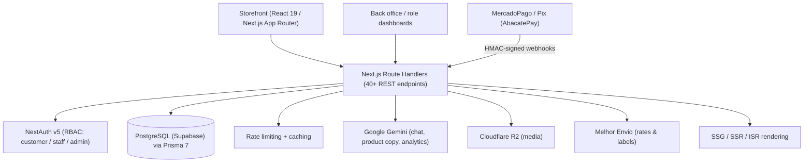

# E-Commerce & Services Platform — Case Study

> **Public case study of a private project.** The source code is private; this repository documents the architecture and engineering decisions. **Live demo:** https://vendaprodutosonline.vercel.app

A production-ready commerce platform that sells **physical products and bookable services** in one storefront, with payments, shipping, a CRM, role-based dashboards and AI-assisted features.

## Overview

The platform combines a customer-facing storefront (catalog, daily deals, cart, checkout, service scheduling) with an operations back office (orders, customers/CRM, catalog management, analytics). It is built as a single **Next.js (App Router)** application with a typed data layer, real payment and shipping integrations, and an AI assistant.

- **Type:** full-stack e-commerce + service-scheduling SaaS
- **Live demo:** https://vendaprodutosonline.vercel.app
- **Status:** private source — available for review on request

## Architecture

## Key features

- **Catalog** of products and services with categories, search and daily deals (time-limited offers).
- **Checkout** with multiple payment methods: credit card and **Pix**, via **MercadoPago** and **AbacatePay**.
- **Shipping** quotes and labels through **Melhor Envio**.
- **Service scheduling** flow alongside product sales.
- **CRM** and **role-based dashboards** (different views for customers, staff and admins).
- **AI assistant** (Google Gemini) for customer chat, product description generation and analytics summaries.
- **SEO**: static, server and incremental rendering (SSG/SSR/ISR) per route.

## Tech stack

| Layer | Technologies |
|---|---|
| Frontend | Next.js (App Router), React 19, TypeScript (strict), Tailwind CSS |
| Backend | Next.js Route Handlers (REST), NextAuth v5 |
| Database | PostgreSQL (Supabase) + Prisma 7 |
| Payments | MercadoPago, Pix via AbacatePay (HMAC-verified webhooks) |
| Shipping | Melhor Envio |
| Storage | Cloudflare R2 |
| AI | Google Gemini (chat, content, analytics) |
| Testing | Vitest |
| Hosting | Vercel |

## Engineering highlights

- **40+ REST endpoints** organized by domain (catalog, cart, orders, payments, scheduling, CRM, analytics).
- **Payment webhooks verified with HMAC signatures** to guarantee authenticity before mutating orders.
- **Role-based access control (RBAC)** across customer, staff and admin areas.
- **Rate limiting** on sensitive endpoints.
- **Composite database indexes** and **offset + cursor pagination** for fast, scalable listings.
- **AI integration** wired into real workflows (support chat, catalog copy, dashboard insights) rather than as a gimmick.
- **SEO-aware rendering** strategy chosen per route (SSG/SSR/ISR).

## Notes

This repository intentionally contains **no source code** — it is a public summary of a private commercial project, created so recruiters can evaluate the architecture and scope. A guided code walkthrough is available on request.
